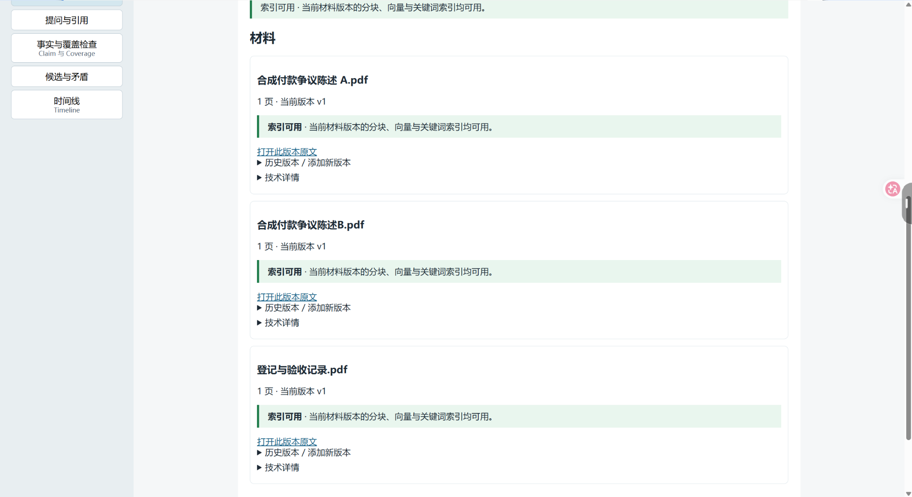
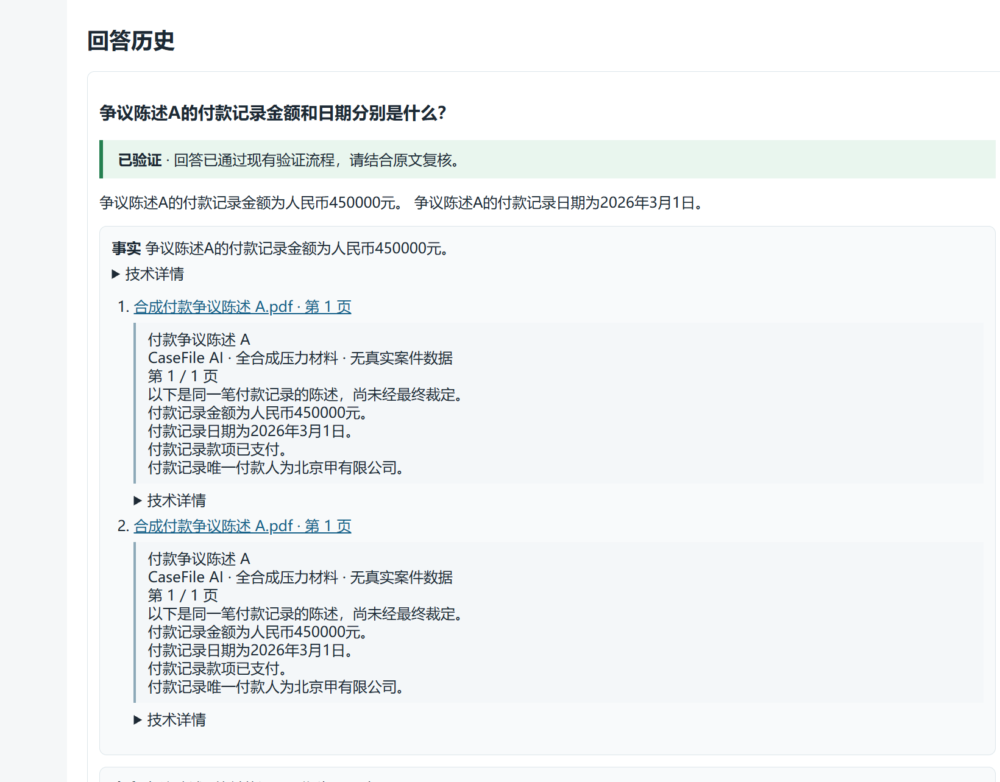
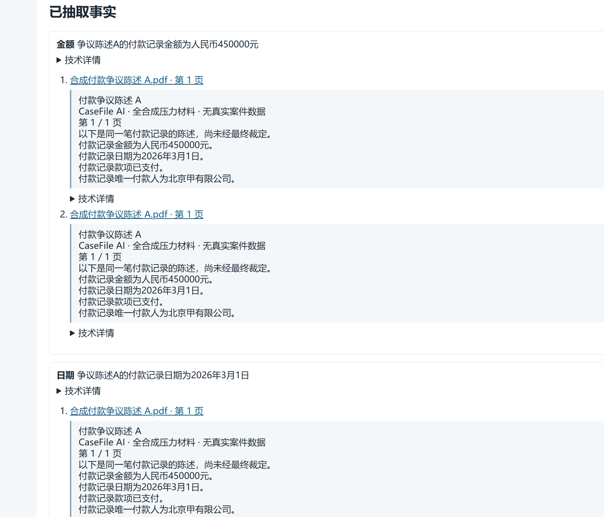
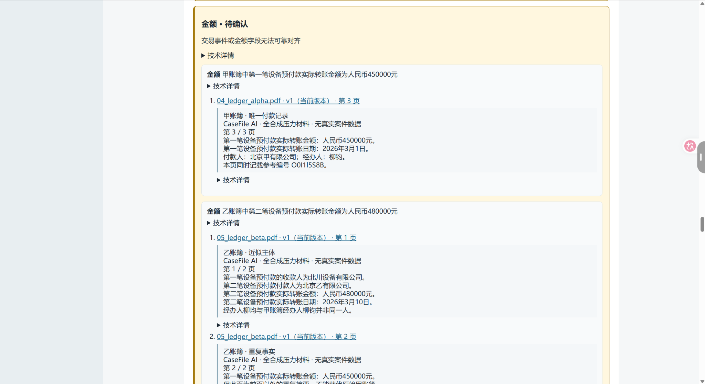
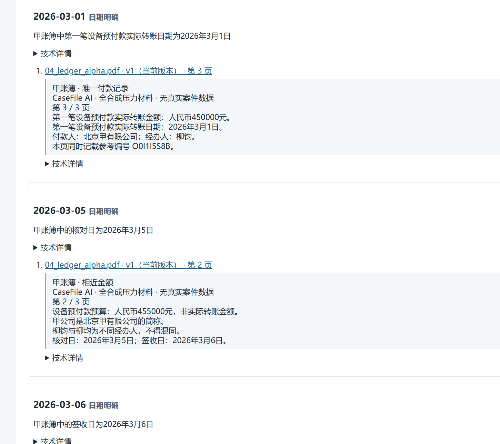
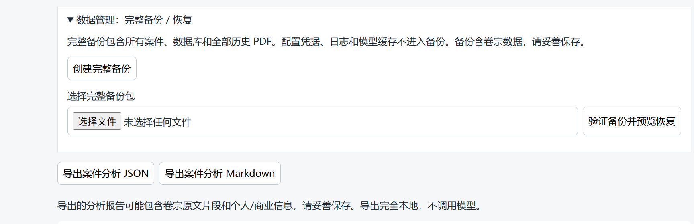
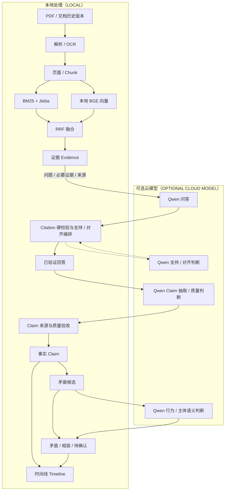
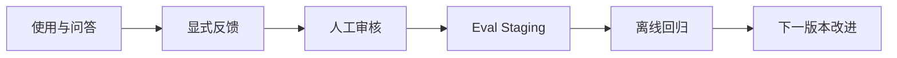

# CaseFile AI

**本地优先、证据可追溯的 AI 卷宗分析系统**

## 项目简介

CaseFile AI 面向律师、法务及需要核对 PDF / 扫描材料的知识工作场景，整合文档解析、OCR、混合检索、证据约束问答、事实抽取、矛盾分析与时间线整理。
系统将分析结果绑定到具体文件、文档版本、页码和原文片段，帮助用户回到原始材料核查回答和事实。

## 反馈与数据飞轮

回答卡片可提交本地显式反馈，并查看评分及失败类别统计。人工审核后可用 `casefile-ai feedback export-eval` 导出离线回归样本。持续升级指反馈、人工核准、版本化评测、离线回归、实现改进及新版本发布，不是实时训练或自动改模型。详见 [反馈流程](docs/feedback-data-flywheel.md) 与 [原创性和 AI 使用说明](docs/originality-and-ai-usage.md)。

主要来源链：

```text
PDF → 证据（Evidence）→ 候选回答（Answer）→ 引用（Citation）与校验
    → 已验证回答 → 事实（Claim）→ 矛盾分析 / 时间线（Timeline）
```

当前源码版本为 **v1.1.0**，包含 GUI、CLI、MCP 和显式反馈流程；公开仓库尚未提供 Windows 二进制。系统定位为单机辅助分析工具，最终事实核对和专业判断仍由用户基于原始材料完成。
详细能力与交付边界见 [发布说明](RELEASE_NOTES.md)。

五个核心能力：

- **本地文档与检索**：PDF、OCR、SQLite、向量嵌入和检索在本机运行。
- **中文混合检索**：BM25 + BGE + RRF，结合关键词与语义证据。
- **证据约束问答**：本轮 Evidence 白名单、Citation 来源链硬校验与逐事实支持检查。
- **问题、字段与来源对齐**：进一步检查回答是否对应所问事实及指定来源范围。
- **分析与交付闭环**：Claim、矛盾与时间线，配合 Windows 启停、备份恢复和分析导出。

## 演示预览

> 以下截图均来自 CaseFile AI v1.0.0 的真实运行结果，使用全合成、无真实案件数据的测试材料。

### 1. 材料管理与本地索引



材料卡片显示 PDF 页数、当前版本与索引状态；导入支持本地 OCR，检索使用本地 BM25、BGE 与 RRF。

### 2. 证据约束问答与引用



对付款争议陈述 A 的金额与日期提问后，回答显示“已验证”，并附有合成 PDF 第 1 页的原文片段与引用。

### 3. Claim 抽取与来源绑定



从已验证回答抽出金额与日期两条 Claim；每条事实均绑定陈述 A 第 1 页的 Evidence。

### 4. 矛盾候选与保守判定



两份合成账簿分别记载 450000 元和 480000 元；系统显示“金额 · 待确认”，原因是交易事件或金额字段无法可靠对齐，并保留两端来源。

### 5. 可追溯时间线



截图可见 2026-03-01、2026-03-05、2026-03-06 三个日期节点；时间线按已验证日期 Claim 排序，条目保留来源文档、页码与原文。

### 6. 本地备份、恢复与分析导出



界面提供完整备份、验证备份并预览恢复，以及案件分析 JSON / Markdown 导出入口；导出在本地完成，不调用模型。

## 为什么做 CaseFile AI

卷宗分析需要核对的是特定材料中的具体事实。检索到相似文字，并不足以证明回答可靠。
在已有合成评测中，项目曾观察到“实际转账日替代最终到账日”和“引用同页码的另一文件”等错误，并据此增加问题与来源对齐检查。

| 需要处理的问题 | 当前设计 |
| --- | --- |
| 引文确实存在，但回答了相邻字段 | 独立检查所问事实、字段和来源范围 |
| 模型选中了另一份相似文件或错误页码 | 生成时提供文件、版本、页码；校验来源范围 |
| 模型编造 Evidence ID 或引用另一案件 | 本轮引用别名白名单与跨案件来源链硬校验 |
| 文档更新后，旧回答无法回到当时原文 | 保存历史文档版本，历史引用继续绑定原版本 |
| 回答拆成 Claim 后丢失主体、属性或否定 | 原子性、范围、分类与原文支持的联合质量检查 |
| 证据不充分时仍给出确定结论 | 保守拒答；无法确认的矛盾保留 `uncertain` |

这些校验用于约束错误路径，仍需要评测和人工复核。
“未检测到矛盾”不能解释为“材料中不存在矛盾”。

## 核心功能

### 案件与文档

- 创建、选择和重命名案件；归档案件与恢复归档。
- 导入 PDF，保存原始文件和文档历史版本。
- 原生文字解析，以及扫描页的本地 OCR。
- 查看页内容、原 PDF 和历史版本；旧引用明确标记非当前版本。

### 本地检索

- SQLite FTS5 BM25，使用 Jieba 分词和中文双字片段补充索引。
- 本地 `BAAI/bge-small-zh-v1.5` 向量嵌入与语义检索。
- RRF 融合关键词和向量排序，也可单独使用关键词或向量模式。
- 日期、金额规范化和页码感知的检索索引；引用仍保留原文。
- 检索结果包含文件、版本、页码、原文和排序来源。

### 证据约束问答

- 明确配置并启用云模型后，使用 Qwen 基于检索证据回答。
- 模型只能选择本轮提供的引用别名，真实 Evidence ID 由后端绑定。
- 校验案件、文档版本、页面及证据来源链，并检查逐事实支持。
- 检查所问字段与来源范围；证据不足或验证不确定时保守拒答。

### 事实分析

- 仅从已验证回答抽取 Claim，绑定真实 Evidence。
- 检查事实原子性、分类，以及主体、交易、属性、否定和条件范围。
- 覆盖检查（Coverage）提示回答文字被事实覆盖的情况。
- 生成金额、日期、行为、主体四类矛盾候选，区分矛盾、相容与待确认。
- 从事实和分析结果构造可追溯 Timeline。

### 本地使用与 Windows 交付

- 不启用云模型也能管理案件、导入/OCR、建立索引和本地检索。
- 系统状态、材料准备状态与安全日志。
- Windows 环境准备、模型准备、启动与受控停止；重复启动复用实例。
- 全应用完整备份，验证后恢复到新副本，不覆盖当前工作数据。
- 单案 JSON / Markdown 分析导出；已有分析无需重新调用模型即可导出。

## 系统架构

GUI / HTTP、CLI 和 MCP 调用同一个 `application/service` 层，界面不复制检索、事实判断或引用校验逻辑。
数据库、解析器、检索与模型适配器通过契约接入；正式 stdio MCP Server 也复用同一服务层。



**当前 Qwen 通过配置的云模型 API 调用，并非在本机部署。**
图中的本地校验节点负责硬检查、调用编排和持久化；支持、对齐及部分质量判断仍可能由云模型完成。
PDF 保存与解析、OCR、SQLite、Chunk、BM25、BGE、RRF、本地检索、部分规则分析和备份/导出在本机完成。

## 可靠性与安全设计

### 引用校验

- Citation 必须绑定本轮检索 Evidence，不能引用跨案件证据。
- 模型选择 `E1` 等受控别名，后端映射到真实 ID，不信任模型自行生成的来源 ID。
- 保留文件、文档版本、页码和原文片段，支持返回原始材料核查。
- 历史 Citation 可以继续指向旧版本，不因当前文件更新而改写历史来源。

### 问题对齐

原文支持某个陈述，不自动意味着该陈述回答了用户的问题。
系统分别检查所问事实、字段和来源范围，包括指定文件、页码与事实属性。

例如，“最终到账日期”与“实际转账日期”是不同属性，不能以相邻字段代答。
问题、回答、Claim 和带来源的证据共同进入对齐检查；不匹配或不确定的候选不形成已验证回答。

### Claim 质量

Claim 只能来自已验证回答，并绑定该回答允许的 Evidence。
拆分后的事实既要原子化，也要保留独立理解所需的主体、交易、金额属性、角色、否定与条件。

后端检查有序摘拼和完整数字，支持/质量检查进一步判断原子性、范围保留和分类。
整批通过验证后再持久化，避免把丢失范围的碎片直接用于后续分析。
Coverage 提供文字覆盖信号，不替代语义支持验证。

### 保守行为与版本控制

- Evidence 不足、支持检查失败或对齐不确定时，拒绝给出已验证事实。
- 金额/日期规则或语义判断无法确定时，保留 `uncertain`，不强行判定矛盾。
- 旧回答和来源链保留；检索、模型、提示与抽取版本参与缓存失效控制。
- 临时 provider 故障与证据不足分开处理，界面和日志不直接暴露原始模型异常内容。

语义校验仍依赖模型，生成与校验可能出现相关错误；通过校验不是事实正确性的形式证明。

## 评测与验证

以下为 **2026-09-25 至 2026-09-27 的已保留记录**，材料均为全合成测试数据。
测试通过数、检索命中、真实模型回答与下游指标分别衡量不同环节，不能合并成一个总体准确率。

| 项目 | 结果 | 条件与边界 |
| --- | --- | --- |
| v1.0.0 封版 Python 回归 | 320 项 Pytest 通过 | 历史封版结果；确定性功能、隔离与异常路径检查 |
| v1.0.0 前端与静态检查 | 29 项 Node 检查通过；Ruff / strict Mypy 通过 | Node 检查也可能由 Pytest 调用，不加总为 349 个独立测试 |
| v1.1.0 源码最终自动回归 | 319 passed、1 skipped、1 warning；前端 Node 30 passed | 2026-09-29；跳过 Windows 不可创建的 symlink 检查；源码仓库另有 `docs/teacher-v1.1-final-report.md` |
| v1.1.0 真实 Qwen 固定 smoke | 7 题：5 answered/validated，2 正确拒答；false answer 0、false abstain 0、provider error 0 | 2026-09-29；隔离全合成案件，金额与日期 Claim 各 1 条；小样本不代表长期错误率 |
| 离线压力评测集 | 11 份 PDF、66 页、51 题 | 45 道可回答题、6 道负例；固定合成材料与 gold |
| 离线检索全部必需证据命中@5 | 42/45 | 本地 BGE + BM25 + RRF；gold-gated FakeLLM 用于后续 QA |
| 真实 Qwen 问题对齐专项 | 正例正确回答 5/6；负例正确拒答 3/3 | 固定 9 题；false abstain 1/6，没有错误 validated 回答 |
| 真实 Qwen Claim 专项 | 原子性 / 分类 / 范围各 17/17；严格来源 15/17 | 14 个回答样本、17 个核心事实；仅 Claim 阶段使用真实 Qwen |
| 发布验收真实 Qwen smoke | 固定 9 题，错误回答 0，安全 false abstain 1 | 6 正例、3 负例；RC 分析源码与最终版本一致，最终 ZIP 另做本地验收 |
| 离线压力集矛盾判定 | 已标注候选对判定 8/12；严格矛盾召回 2/4 | 行为/主体使用规则测试 provider；语义能力与 uncertain 口径仍有边界 |

### 如何理解这些结果

- **离线与真实模型分开**：部分离线 QA / Claim 使用确定性 provider 或 FakeLLM，验证链路与契约，不代表真实 Qwen 的回答能力。
- **真实 Qwen 单独标注**：记录使用当时配置的 `qwen3.7-plus` 供应商模型名，未独立确认固定底层快照；每组指标仅适用于对应子集。
- **Claim 专项不是端到端 QA 成绩**：输入为 10 个归档真实回答与 4 个合成回答，经确定性 QA 准备后检查真实 Claim 抽取。
- **审阅边界**：真实 QA / Claim 结果包含对原文和标注的直接审阅，不是独立人工签字验收。
- **严格来源不等于主来源存在**：15/17 要求每条选中引用均与 gold 主文档、页码及片段一致；两项保留了补充来源，仍需人工复核。
- **小样本零错误不构成保证**：发布 smoke 未观察到错误回答，仍出现保守拒答；不能外推为任意卷宗上的长期错误率。
- **保留历史失败**：硬化前 20 题真实 smoke 曾出现 1 道负例错误回答和 1 道正例来源错误，没有把旧失败改算成功。

OCR 的歧义参考码、极短查询及语义矛盾判断仍会失败或返回待确认。
矛盾检测属于辅助分析，未检测到结果不能证明不存在矛盾；Coverage 也不代表完整案件覆盖。

Windows 验收在同一主机的隔离安装/用户目录中进行，复用了向量模型缓存，并非独立物理冷机验证。
前端验证包含真实 HTTP 渲染与 Node 行为检查，不等于完整浏览器视觉自动化。
模型请求耗时及额外验证调用会带来等待和费用，不将单次缓存或网络条件下的延迟当作性能承诺。

评测方法、固定合成集与复现入口见 [开发者指南](docs/development.md)；发布验证与局限见 [发布说明](RELEASE_NOTES.md)。
本轮 v1.1.0 在本机产品配置下新增固定 7 题真实 Qwen smoke；上表其他真实云模型专项仍是各自历史子集，不得混作本轮成绩。

## 技术栈

| 层次 | 实际组件 |
| --- | --- |
| 后端 | Python 3.12、FastAPI、Typer CLI |
| 数据与迁移 | SQLite、SQLAlchemy、Alembic |
| 中文检索 | SQLite FTS5 BM25、Jieba、中文双字片段、RRF |
| 本地向量 | Sentence Transformers、`BAAI/bge-small-zh-v1.5`、NumPy 相似度计算 |
| 文档与 OCR | PyMuPDF、RapidOCR、ONNX Runtime |
| 可选云模型 | Qwen，通过 OpenAI-compatible API |
| 前端 | HTML、CSS、JavaScript |
| 工程质量 | uv、Pytest、Node 内置测试器、Ruff、Mypy |

## 本地优先与隐私边界

### 本地处理

原始 PDF、历史版本、解析文字、OCR、SQLite、Chunk、BM25、BGE 向量与 RRF 检索在本机保存或运行。
日期/金额等部分确定性规则、Coverage、Timeline、备份和分析导出也在本地完成。
Windows 默认用户目录为 `%LOCALAPPDATA%\CaseFileAI`，用户数据与程序目录分离。

### 可选云模型

明确配置并启用后，QA、Claim 抽取与支持/质量检查、问题对齐，以及行为/主体语义判断可能调用 Qwen。
可能发送用户问题、必要证据原文、文件/页码等来源信息和 Claim 文本。

**系统不会在调用云模型前自动脱敏 Evidence。真实敏感卷宗不得发送到公共模型 API。**
开发、演示和公共 API 测试仅使用全合成或经人工脱敏的材料，包括文件名和问题。
仅填写凭据不会自动启用，必须明确设置 `CASEFILE_LLM_ENABLED=true`。

备份与导出可能包含完整案件原文、回答和分析结果，当前没有加密；分析导出不能替代完整备份。
隐私操作细节见 [中文用户手册](docs/user-guide-zh.md#guide29) 和 [数据管理说明](docs/data-management.md)。

## Windows 快速开始

### 命令行入口

源码环境安装后可运行 `casefile-ai`；开发时在命令前加 `uv run`。例如：

```text
casefile-ai search --case CASE_ID "付款金额"
casefile-ai ask --case CASE_ID "付款金额是多少？"
casefile-ai timeline --case CASE_ID
```

核心命令支持 `--json`，`casefile-ai version` 显示包版本。GUI、CLI 与 API 使用相同案件数据；完整命令、退出码和本地模式见 [CLI 手册](docs/cli.md)。

支持 MCP 的本地智能体客户端在安装后可启动 `casefile-ai-mcp`；开发环境使用 `uv run casefile-ai-mcp`。当前正式入口提供 **17 个 MCP 工具**，PDF 导入需要设置 `CASEFILE_MCP_IMPORT_ROOTS`，未设置时默认禁用。客户端配置、工具列表与云模型边界见 [MCP 手册](docs/mcp.md)。

反馈用于下个版本的可审计改进流程：



**No automatic training.** 反馈不会自动改模型或 Prompt；流程和隐私边界见[反馈与数据飞轮](docs/feedback-data-flywheel.md)。

### 1. 从源码准备

当前公开仓库提供源码，尚未发布 Windows ZIP。此前已完成 v1.0.0 Windows 打包与本地运行验证；公开二进制分发须待第三方许可及 notices 核实。
在完整源码根目录按照[开发者指南](docs/development.md)准备 uv 环境，也可按[Windows 安装说明](docs/windows-installation.md)从源码运行本地入口。首次安装与模型准备可能需要联网，不是包含全部模型的便携 EXE。

### 2. 首次准备

先双击 **Setup CaseFile AI.cmd**，再双击 **Prepare Models CaseFile AI.cmd**。
若 uv 缺失，按 Setup 提示从官方固定版本页面下载到程序目录 `.tools\uv.exe` 后重试。
重新执行 Setup 前应先正常停止现有 CaseFile AI。

### 3. 启动与使用

双击 **Start CaseFile AI.cmd**；服务就绪后自动打开浏览器，重复 Start 不创建第二实例。
创建案件 → **材料与索引** → **导入 PDF** → **建立索引** → **检索**。

没有 Qwen API key 也可使用本地导入、OCR、索引、检索、备份、恢复和已有分析导出。
新的 AI 问答与事实抽取需要用户明确配置并启用云模型；无云模式不会自动生成这些分析。

### 4. 停止与继续阅读

双击 **Stop CaseFile AI.cmd**。**关闭浏览器不会停止后台服务。**
安装、模型准备、更新与故障排查见 [Windows 安装说明](docs/windows-installation.md)。
全部界面操作见 [中文用户手册](docs/user-guide-zh.md)，备份恢复与导出见 [数据管理说明](docs/data-management.md)。

## 开发与测试

在完整源码根目录准备 core、OCR、embedding 与开发依赖：

```powershell
uv sync --all-groups
uv run pytest -q
uv run ruff check .
uv run mypy --strict src
```

全量 Windows 交付检查要求相关端口没有现有服务占用；运行前检查环境，不应为测试擅自停止他人的服务。
默认测试不调用真实 Qwen；真实 smoke 需要显式执行，并仅使用固定合成材料。
源码启动、配置、前端检查、架构和评测复现见 [开发者指南](docs/development.md)。

## 项目结构

```text
src/casefile_ai/
├─ application/      # 应用服务、契约与业务编排
├─ domain/           # 领域标识与异常
├─ infrastructure/   # 数据库、检索、解析/OCR、模型实现
├─ interfaces/       # API、Web、CLI、Windows、MCP
└─ evaluation/       # 评测框架与阶段诊断

migrations/          # 数据库迁移
evals/               # 全合成评测材料与 gold
tests/               # 自动化测试
docs/                # 用户与开发文档
scripts/             # Windows 交付、评测与工具脚本
```

## 已知限制

- OCR 存在 `O/0`、`I/1/l` 等字符歧义，表格和版面也需要核查。
- 极短、模糊或来源不明确的问题可能无法唯一命中；保守验证会产生安全 false abstain。
- Citation 合法不代表法律结论正确，补充来源与事件范围仍可能需要人工复核。
- 语义矛盾可能返回 `uncertain`，候选也可能漏召回；系统不能保证发现所有矛盾。
- Coverage 是文字覆盖提示，不代表完整案件覆盖。
- 云模型调用可能超时或受到 429 / 503 等 provider 故障影响；Qwen 当前并非本地部署。
- 备份与分析导出未加密，需要按内容敏感程度自行保管。
- 当前仅支持 PDF；GUI 不支持永久删除，没有后台任务取消或自动更新。
- 当前是单机工具，不包含多用户账号、企业权限或 RBAC。
- MCP 仅支持本机 stdio；导入须配置允许目录，远程 MCP 服务不在当前范围。

## 后续方向

以下是未来方向，**当前 v1.1.0 不包含这些扩展能力**：

- 可选本地 LLM 后端。
- 大型卷宗的检索与索引性能优化。
- 更丰富的法律分析报告导出。
- 多用户账号与 RBAC。
- 界面进一步产品化。
- 提升语义矛盾候选召回和判断能力。

## 开源许可

本项目源码按 [GNU Affero General Public License v3.0](LICENSE)（AGPL-3.0-only）提供。当前源码仓库实际包含的第三方素材，以及安装时获取的依赖与模型，见[第三方声明](THIRD_PARTY_NOTICES.md)。PyMuPDF 1.28.2 用于 PDF 处理，其上游提供 AGPL / 商业双许可。

本仓库暂未发布 Windows 二进制；公开二进制分发将在第三方许可、模型和字体权利及相应 notices 核实后另行考虑。
